 

  
  

## My Tools and Technologies

    <table align="center">
        <tr>
            <td align="center" width="96">
                
                 HTML
            </td>
            <td align="center" width="96">
                
                 CSS
            </td>
            <td align="center" width="96">
                
                 Bootstrap
            </td>
            <td align="center" width="96">
                
                 JavaScript
            </td>
            <td align="center" width="96">
                
                 JQuery
            </td>
            <td align="center" width="96">
                
                 Git
            </td>
            <td align="center" width="96">
                
                 Bash
            </td>
        </tr>
        <tr>
            <td align="center" width="96">
                
                 C
            </td>
            <td align="center" width="96">
                
                 C++
            </td>
            <td align="center" width="96">
                
                 Java
            </td>
            <td align="center" width="96">
                
                 Python
            </td>
            <td align="center" width="96">
                
                 NumPy
            </td>
            <td align="center" width="96">
                
                 Pandas
            </td>
            <td align="center" width="96">
                
                 Django
            </td>
        </tr>
        <tr>
            <td align="center" width="96">
                
                 Matplotlib
            </td>
            <td align="center" width="96">
                
                 Jupyter
            </td>
            <td align="center" width="96">
                
                 AWS
            </td>
            <td align="center" width="96">
                
                 Nodejs
            </td><td align="center" width="96">
                
                 NPM
            </td><td align="center" width="96">
                
                 Express
            </td>
            <td align="center" width="96">
                
                 Sqlite
            </td>
        </tr>
        <tr>
            <td align="center" width="96">
                
                 PostgreSQL
            </td>
            <td align="center" width="96">
                
                 GraphQL
            </td>
            <td align="center" width="96">
                
                 Linux
            </td>
            <td align="center" width="96">
                
                 Ubuntu
            </td>
            <td align="center" width="96">
                
                 Docker
            </td>
            <td align="center" width="96">
                
                 Postman
            </td>
            <td align="center" width="96">
                
                 Arduino
            </td>
        </tr>
        <tr>
            <td align="center" width="96">
                
                 Autocad
            </td>
        </tr>
    </table>
     
     

    </body>
</html>